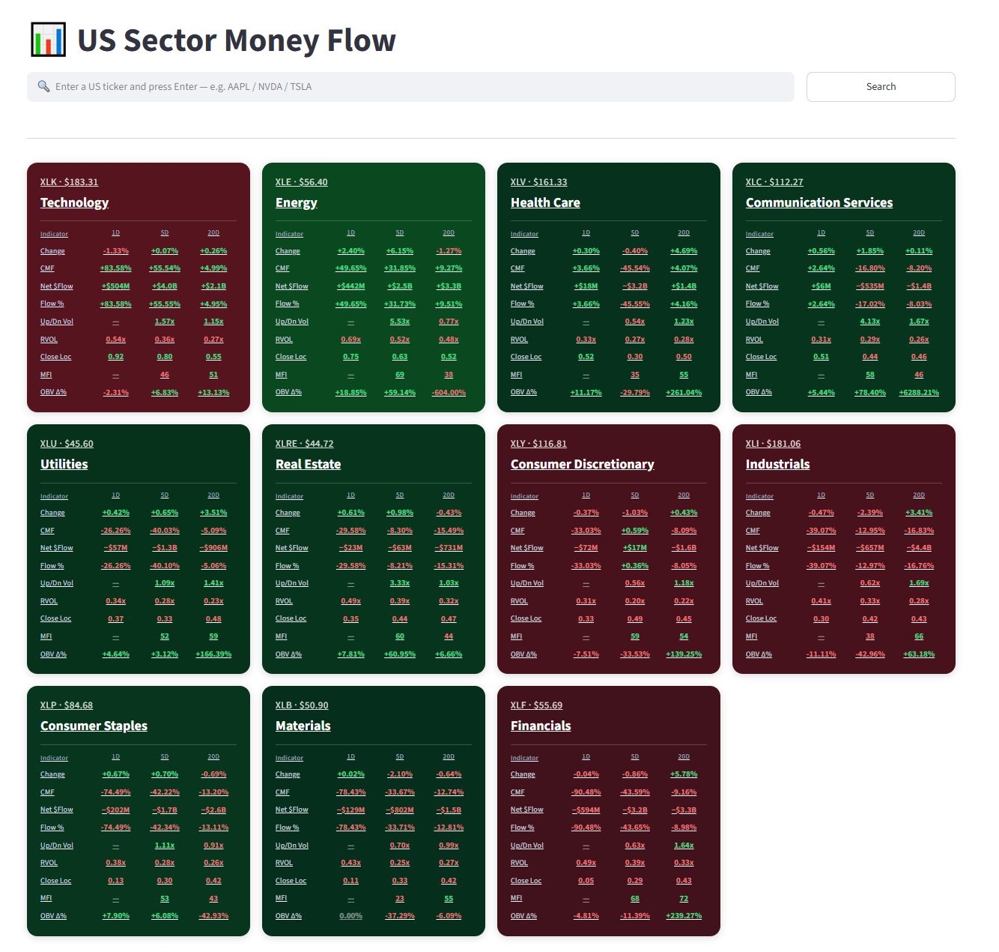
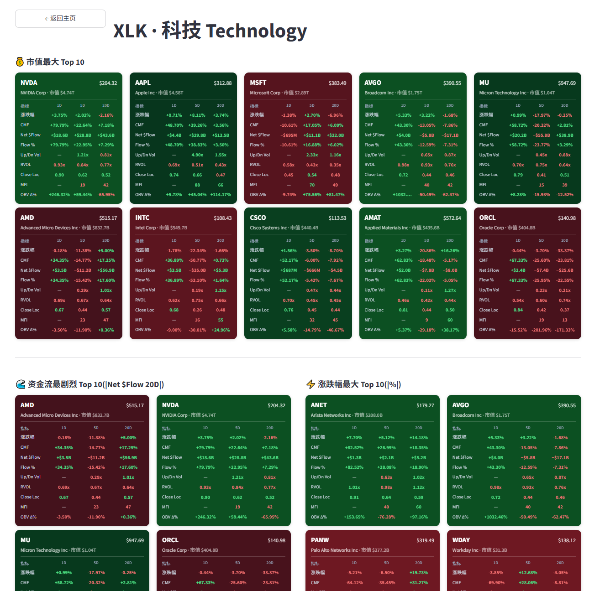

# 📊 Sector Flow

[](https://github.com/czcode0501)
[](https://python.org)
[](https://streamlit.io)
[](LICENSE)

> **分类：📊 金融 & 数据可视化** — 本项目属于 `金融 / 数据可视化` 类别。
>
> **Real-time US stock sector money-flow dashboard, self-hosted and open source.**

A dark-mode Streamlit app that tracks buy/sell pressure across all 11 SPDR sector ETFs and their top holdings — 9 professional indicators computed at 3 time windows each (1-day / 5-day / 20-day), silently auto-refreshed, with flip-clock number animations.


---

## 📂 Project Classification

| Category | Description |
|----------|-------------|
| 📊 **Finance & Data Visualization** | Real-time US stock sector money-flow dashboard with 9 professional indicators |

## 📸 Screenshots

**Main dashboard — 11 sectors sorted by today's money flow (green = inflow, red = outflow):**



**Sector drill-down — market-cap Top 10 + most-extreme money flow + biggest movers:**



---

## 🎯 Why this exists

Traditional broker terminals show you *price*. Sector Flow shows you **where money is actually going** — the volume-weighted pressure behind those prices — normalized across 8 different lenses so you can spot rotation, exhaustion, and accumulation that raw price charts hide.

Built for the individual investor / trader who wants an at-a-glance sector heatmap without paying $2,000/month for a Bloomberg terminal.

## ✨ Features

- **11 SPDR sector ETFs** on one page, auto-sorted by 1-day CMF (strongest inflow first)
- **Click any sector** → drill into ~30 top holdings with three rankings:
  - 💰 **Market-cap Top 10** — the mega-caps that move the sector
  - 🌊 **Most extreme Net $Flow** — where the biggest dollar volumes are landing/leaving
  - ⚡ **Biggest movers** — largest absolute % changes
- **🔍 Ticker search** — type any US stock (`AAPL`, `NVDA`, `TSLA`…) → full metrics table
- **9 indicators × 3 time windows** on every card (see [Metrics Explained](#-metrics-explained))
- **Zero-flicker refresh** — Streamlit `@st.fragment(run_every=...)` re-renders only data cells, not the page. Sidebar controls, scroll position, and even the search box stay untouched.
- **Flip-clock number animation** — new values rotate in on a 3D X-axis, 0.45 s cubic ease. Old value never briefly flashes as "loading".
- **Dark theme with hue tinting** — cards are dark green (positive day) or dark red (negative day); vivid bright numbers pop against the dark base for readability.
- **Windows one-click launcher** — `launch.bat` and a desktop shortcut that starts Streamlit if it's not running and opens the browser.
- **~500 lines of Python** — no build tools, no bundler, no framework. Read the code in an afternoon.

## 📊 Metrics Explained

Every card shows a compact 9-row × 3-column table. Rows are indicators; columns are lookback periods.

| Row | What it measures | Formula (per period *N*) | Color rule |
|---|---|---|---|
| **涨跌幅** (Price Change) | Return relative to *N* trading days ago | `(close_today / close_{-N}) − 1` | +/− vs zero |
| **CMF** | Chaikin Money Flow — where volume was transacted within each day's range | `Σ(MFM × Volume) / Σ(Volume)` where `MFM = ((C−L)−(H−C))/(H−L)` | +/− vs zero |
| **Net $Flow** | Net directional dollar volume — proxy for aggressive buy − aggressive sell | `Σ(MFM × Volume × TypicalPrice)` | +/− vs zero |
| **Flow %** | Same as Net $Flow but normalized so sectors of different size are comparable | `NetDollarFlow / Σ(Volume × TypicalPrice)` | +/− vs zero |
| **Up/Dn Vol** | Ratio of up-day volume to down-day volume over *N* days | `Σ Volume(close↑) / Σ Volume(close↓)` | >1 = green |
| **RVOL** | Today's volume vs. its N-day average — is this an above-average day? Intraday, the average is pro-rated by the elapsed share of the session | `Volume_today / (mean(Volume_{−N…−1}) × elapsed)` | >1 = green |
| **Close Loc** | Where the close landed inside the day's H-L range, averaged over *N* days | `mean( (Close − Low) / (High − Low) )` | >0.5 = green |
| **MFI** | Money Flow Index — like RSI but weighted by dollar volume | `100 − 100/(1 + posMoneyFlow/negMoneyFlow)` over *N* periods | >50 = green |
| **OBV Net %** | Net On-Balance Volume over *N* days as a share of total volume (bounded ±100 %) | `Σ(sign(ΔClose) × Volume) / Σ Volume` | +/− vs zero |

**Time windows**: 1D (today only), 5D (~one trading week), 20D (~one trading month).

**Cells that show "—"** are values that don't make mathematical sense at that window — e.g., 1D Up/Dn Vol needs at least two days of price direction to form a ratio.

## 🏗️ How it works

```
┌─────────────────────────────────────────────────────────┐
│  Browser (dark UI, flip-clock animations, auto-refresh) │
└─────────────────┬───────────────────────────────────────┘
                  │  every 15 s: @st.fragment reruns
                  ▼
┌─────────────────────────────────────────────────────────┐
│  Streamlit (Python fragment, cached data layer)         │
└───────────────┬─────────────────┬───────────────────────┘
                │                 │
                ▼                 ▼
     ┌──────────────────┐  ┌──────────────────┐
     │  Finnhub /quote  │  │  yfinance        │
     │  real-time price │  │  daily OHLCV     │
     │  cache 15 s      │  │  cache 1 hour    │
     └──────────────────┘  └──────────────────┘
```

**Two data sources, split by refresh cadence:**
- **Finnhub `/quote`** for real-time price & today's % change (updates every 15 s). Free tier caps at 60 calls/min — see [Rate limits](#️-rate-limits).
- **yfinance** for the 3-month daily OHLCV window we need to compute CMF/MFI/OBV. Cached 1 hour — daily indicators don't need faster refresh.

**Everything runs in-process, in-memory.** No database, no Redis, no worker queue. Streamlit's `@st.cache_data(ttl=...)` gives us bounded memory with automatic expiry.

## 🚀 Quick start

**Requirements**: Python 3.10 or newer, a free [Finnhub API key](https://finnhub.io/register).

```bash
git clone https://github.com/czcode0501/sector-flow.git
cd sector-flow
pip install -r requirements.txt
cp .env.example .env    # or copy on Windows
```

Open `.env` in any text editor and paste your Finnhub key after `FINNHUB_API_KEY=`.

```bash
python -m streamlit run app.py
```

Open **http://127.0.0.1:8501** in your browser.

> 🔒 `.streamlit/config.toml` binds the server to `127.0.0.1`. The app has no login and every visitor spends your Finnhub quota, so only expose it on a network behind your own authentication.

Run the offline test suite (no network or API key needed):

```bash
pip install pytest
python -m pytest -q tests
```

### Windows: one-click launcher

Double-click `launch.bat` — it starts Streamlit (if not running) and opens your default browser. To pin to the desktop, right-click `launch.bat` → *Create shortcut* → drag to Desktop, or run the PowerShell snippet at the bottom of this file.

## ⚙️ Configuration

| File | Purpose |
|---|---|
| `.env` | Your `FINNHUB_API_KEY` — **never committed** (in `.gitignore`) |
| `sectors.py` | The 11 sector ETFs + top-30 constituent stock lists per sector |
| `data.py` | HTTP fetchers, indicator computations, caching layer |
| `app.py` | Streamlit UI: routing, fragments, CSS, card rendering |
| `launch.py` / `launch.bat` | Windows one-click launcher |
| `requirements.txt` | pip dependencies |

### Customization tips

- **Change the constituent stocks** for a sector: edit `SECTOR_STOCKS` in `sectors.py`. Any US ticker Yahoo Finance recognizes will work. `BRK.B`-style dots are auto-converted to `BRK-B` for yfinance.
- **Change sector sort key**: `app.py` → `_inflow_key()` inside `sector_grid`. Default sorts by 1-day CMF. Swap to `net_flow` for absolute dollar sorting, or `5` / `20` for medium/long-term.
- **Change refresh cadence**: sidebar slider (5–60 s). Default 15 s.
- **Change color palette**: `color_for()` in `app.py`, and the `.cmf-in` / `.cmf-out` CSS classes.

## ⏱️ Rate limits

Finnhub free tier is **60 calls/min**. `429 Too Many Requests` is a per-minute cap and **auto-recovers within a minute** — no daily/weekly quota, no bans.

| Page | Calls/min at 15s refresh | Status |
|---|---|---|
| Main dashboard (11 sector quotes) | ~44 | ✅ safe |
| Sector detail (~30 stock quotes) | ~120 | ⚠️ may hit 429 |

The app now has a built-in process-wide limiter (default **55 calls/min**, override with `FINNHUB_CALLS_PER_MIN` in `.env`). Requests over the budget are not sent; the last good quote stays on screen and the symbol is refreshed on a later tick. A real 429 pauses all Finnhub calls for the `Retry-After` period. Failed lookups are retried after minutes, not cached for the full TTL.

**Mitigations if refreshes feel slow on the sector page:**
1. Raise sector detail refresh to **30 s** (sidebar slider) → 60 calls/min → safe
2. Thin the constituent lists in `sectors.py` from 30 to ~20 tickers
3. Upgrade Finnhub (paid tier removes the cap)

Historical (yfinance) calls are unlimited but are cached for 1 hour, so they cost ~1 call per sector visited per hour.

## 🗺️ Roadmap

- [ ] Historical trend charts (CMF over time, per stock)
- [ ] Compare mode — side-by-side sector or stock diff
- [ ] Alerts — Slack / email / desktop when CMF crosses threshold
- [ ] Configurable indicator thresholds and columns
- [ ] Extended-hours data
- [ ] Non-SPDR ETF support (Vanguard VIS, iShares IYK, etc.)
- [ ] Fundamental overlay (P/E, revenue growth)
- [ ] Deployable Docker image

PRs welcome — open an issue first if it's a big feature so we can align on approach.

## 🩹 Troubleshooting

**"未检测到 FINNHUB_API_KEY"** — Your `.env` is missing or not in the project root. Copy `.env.example` to `.env` and paste your key.

**Data shows "—" for a stock** — Either Finnhub rate-limited that request (wait a minute) or yfinance can't find that ticker.

**Cards look identical / all gray** — The metrics API failed. Check the terminal running Streamlit for tracebacks.

**Streamlit "Running..." indicator appears** — Update to latest code; the CSS block should hide `[data-testid="stStatusWidget"]`.

**Windows launcher doesn't open browser** — Confirm Python is on your `PATH`. Try `python launch.py` from a terminal to see errors.

## 🤝 Contributing

Fork → branch → PR. Small changes (typos, docstrings) welcome directly. For anything larger:
1. Open an issue describing the problem or feature
2. Wait for a "sounds good" reaction before writing code
3. Keep PRs small and focused

## 📜 License

MIT — see [LICENSE](LICENSE). Do whatever you want, just keep the copyright notice.

## ⚠️ Disclaimer

**For educational and personal research use only. Not financial advice.** Data can be delayed, incomplete, or wrong. The indicators are approximations of institutional flow, not measured order flow. Do not trade based solely on what this app shows you. Past patterns do not predict future returns.

---

<br>

# 中文说明

一个**自托管、开源**的美股板块资金流实时仪表盘 —— 深色主题 Streamlit 应用,追踪 11 大 SPDR 板块 ETF 及其成分股的买卖压力。9 个专业指标 × 3 个时间窗口(1 日 / 5 日 / 20 日),15 秒静默刷新,数字翻页动画。

## 🎯 为什么做这个

券商行情软件只给你**价格**。Sector Flow 告诉你**钱去哪了** —— 价格背后的资金压力,用 8 个不同角度呈现,让你看见轮动、见顶、吸筹这些光看 K 线看不出的信号。

给不想每月花 2000 美元买彭博终端、但又想一屏抓住板块热度的个人投资者用。

## ✨ 主要功能

- **11 个 SPDR 板块 ETF** 同屏,按今日 1D CMF 自动排序(流入最多在最前)
- **点击任意板块** → 下钻查看 ~30 只成分股,分三个榜单:
  - 💰 **市值 Top 10** —— 主导板块走势的巨头
  - 🌊 **Net $Flow 最剧烈 Top 10** —— 最大金额资金进出
  - ⚡ **涨跌幅最大 Top 10** —— 单日涨跌最凶的
- **🔍 代码搜索** —— 输入任意美股代码,秒出完整指标表
- **9 个指标 × 3 个时间窗口**(见下方 [指标说明](#-指标说明))
- **零闪烁刷新** —— 用 Streamlit `@st.fragment(run_every=...)` 只重刷数据格子,页面其他部分(标题、侧栏、搜索框、滚动位置)完全不动
- **数字翻页动画** —— 新数据来时 0.45 秒 3D 翻转,不会先闪 loading 再显示
- **深色主题 + 色调提示** —— 卡片底色是深墨绿(上涨)/ 深酒红(下跌),鲜艳数字在深底上一眼分清
- **Windows 一键快捷方式** —— 桌面双击 `launch.bat` 就启动 + 打开浏览器
- **~500 行 Python** —— 无构建工具、无打包器、无重型框架,一下午读得完

## 📊 指标说明

每张卡片底部是 9 行 × 3 列的紧凑表。行是指标,列是回溯周期。

| 指标 | 含义 | 公式(周期 *N*) | 上色 |
|---|---|---|---|
| **涨跌幅** | 相对 N 日前收盘的回报 | `(收今 / 收_{-N}) − 1` | 正=绿 |
| **CMF** | 蔡金资金流 —— 成交量落在当日区间哪个位置 | `Σ(MFM × 成交量) / Σ(成交量)`,其中 `MFM = ((C−L)−(H−C))/(H−L)` | 正=绿 |
| **Net $Flow** | 净方向性成交金额 —— 主动买 − 主动卖 的估算 | `Σ(MFM × 成交量 × 典型价)` | 正=绿 |
| **Flow %** | 净流入 ÷ 总成交金额(消除板块规模差) | `NetDollarFlow / Σ(成交量 × 典型价)` | 正=绿 |
| **Up/Dn Vol** | N 天内上涨日成交量 ÷ 下跌日成交量 | `Σ 涨日成交量 / Σ 跌日成交量` | >1=绿 |
| **RVOL** | 今日成交量 ÷ N 日均量 —— 是否放量;盘中按已过交易时段比例折算均量 | `今日量 / (mean(近 N 日量) × 已过时段占比)` | >1=绿 |
| **Close Loc** | 收盘价在当日 H-L 区间的位置,N 日平均 | `mean( (Close − Low) / (High − Low) )` | >0.5=绿 |
| **MFI** | 资金流量指标 —— 加权成交金额版的 RSI | `100 − 100/(1 + 正MFV/负MFV)` 累计 N 期 | >50=绿 |
| **OBV Net %** | N 日净 OBV 占总成交量的比例(范围 ±100%) | `Σ(sign(ΔClose) × Volume) / Σ Volume` | 正=绿 |

**时间窗口**:1D = 只看今天;5D ≈ 一个交易周;20D ≈ 一个交易月。

**显示"—"的格子**是那个窗口下数学上不成立的值 —— 比如 1D 的 Up/Dn Vol 只有一天没法算涨跌成交量比。

## 🏗️ 工作原理

```
┌─────────────────────────────────────────────────────────┐
│  浏览器(深色 UI · 翻页动画 · 静默自动刷新)              │
└─────────────────┬───────────────────────────────────────┘
                  │  每 15 秒 @st.fragment 重跑
                  ▼
┌─────────────────────────────────────────────────────────┐
│  Streamlit(Python fragment · 缓存层)                    │
└───────────────┬─────────────────┬───────────────────────┘
                │                 │
                ▼                 ▼
     ┌──────────────────┐  ┌──────────────────┐
     │  Finnhub /quote  │  │  yfinance        │
     │  实时报价         │  │  日线 OHLCV       │
     │  缓存 15 秒       │  │  缓存 1 小时       │
     └──────────────────┘  └──────────────────┘
```

**两个数据源,按刷新节奏分工**:
- **Finnhub `/quote`** 拿实时价 + 今日涨跌幅(每 15 秒新)。免费档 60 次/分钟。
- **yfinance** 拿 3 个月日线,用来算 CMF / MFI / OBV。缓存 1 小时 —— 日线指标不需要更快。

**全部在进程内存里跑,零依赖**:没有数据库、Redis、队列。Streamlit 的 `@st.cache_data(ttl=...)` 自动过期清理,内存有界。

## 🚀 快速开始

**环境**:Python 3.10+ · 免费的 [Finnhub API key](https://finnhub.io/register)

```bash
git clone https://github.com/czcode0501/sector-flow.git
cd sector-flow
pip install -r requirements.txt
cp .env.example .env
```

用任意文本编辑器打开 `.env`,把你的 Finnhub key 贴在 `FINNHUB_API_KEY=` 后面。

```bash
python -m streamlit run app.py
```

浏览器打开 **http://127.0.0.1:8501**(`.streamlit/config.toml` 只监听本机;本应用没有登录,别直接暴露到局域网/公网)

### Windows 一键启动

双击 `launch.bat` —— 会自动检查是否已运行,没运行就启动 Streamlit,然后打开浏览器。想放桌面就右键 `launch.bat` → *创建快捷方式* → 拖到桌面。

## ⚙️ 目录结构

| 文件 | 作用 |
|---|---|
| `.env` | 你的 `FINNHUB_API_KEY` —— **永不提交**(`.gitignore` 已排除) |
| `sectors.py` | 11 个 ETF + 每板块 30 只主要成分股 |
| `data.py` | HTTP 拉数 · 指标计算 · 缓存 |
| `app.py` | Streamlit UI · 路由 · fragment · CSS · 卡片渲染 |
| `launch.py` / `launch.bat` | Windows 快捷启动 |

### 常见改动

- **换成分股列表**:改 `sectors.py` 里的 `SECTOR_STOCKS`。任何 Yahoo Finance 认得的美股代码都行。`BRK.B` 这种带点的代码会自动转成 yfinance 的 `BRK-B`。
- **改板块排序依据**:`app.py` 里 `sector_grid` 中的 `_inflow_key()`。默认按 1 日 CMF,想按绝对金额就换成 `net_flow`,想看中期就换 `5` 或 `20`。
- **改刷新间隔**:侧栏滑块(5-60 秒)。默认 15 秒。
- **改配色**:`app.py` 里的 `color_for()` 函数 + `.cmf-in` / `.cmf-out` CSS 类。

## ⏱️ API 限速

Finnhub 免费档 **60 次/分钟**。`429 Too Many Requests` 是**每分钟**限,过一分钟自动恢复,不是每天/每周额度,不会封号。

| 页面 | 15 秒刷新时的每分钟调用 | 状态 |
|---|---|---|
| 主页(11 个板块报价) | ~44 | ✅ 稳 |
| 板块详情页(~30 只股票报价) | ~120 | ⚠️ 可能 429 |

**避免 429 的方法**(任选其一):
1. 详情页刷新间隔调到 **30 秒**(侧栏拉滑块)→ 60 次/分钟 → 稳
2. 把 `sectors.py` 里每板块成分股从 30 只砍到 ~20 只
3. 升级 Finnhub 付费档

历史数据(yfinance)没限速,而且缓存 1 小时,基本每小时每个访问过的板块只请求一次。

## 🩹 常见问题

**"未检测到 FINNHUB_API_KEY"** —— `.env` 不在项目根目录或没填。把 `.env.example` 复制成 `.env` 再填。

**某只股票所有格子都是"—"** —— 要么是 Finnhub 限流(等一分钟),要么 yfinance 找不到那个代码。

**卡片全都灰色 / 没数据** —— 指标 API 失败。看跑 Streamlit 的终端有没有报错。

**右上角还看得到 "Running…"** —— 更新到最新代码,CSS 已经隐藏 `[data-testid="stStatusWidget"]`。

**Windows 快捷方式没打开浏览器** —— 确认 Python 在 `PATH` 里。命令行跑 `python launch.py` 看报错信息。

## 🗺️ 路线图

- [ ] 历史趋势图(CMF 随时间变化)
- [ ] 对比模式 —— 板块之间 / 股票之间并排看
- [ ] 告警 —— CMF 破阈值时 Slack / 邮件 / 桌面通知
- [ ] 可配置指标阈值与列
- [ ] 盘前盘后数据
- [ ] 支持非 SPDR 板块 ETF(Vanguard VIS / iShares IYK 等)
- [ ] 基本面叠加(市盈率、营收增长)
- [ ] 可部署的 Docker 镜像

欢迎 PR —— 大改动请先开 issue 讨论方向。

## 📜 授权

MIT —— 见 [LICENSE](LICENSE)。随便用,保留版权声明就行。

## ⚠️ 免责声明

**仅供学习和个人研究,不构成任何投资建议。** 数据可能延迟、缺失或错误。指标是对机构资金流的**近似估算**,不是实测订单流。请勿单纯依据本应用做出交易决策。历史规律不预测未来收益。

---

<sub>Built with ❤️ by [@czcode0501](https://github.com/czcode0501). If this project helped you, please star ⭐ the repo.</sub>
